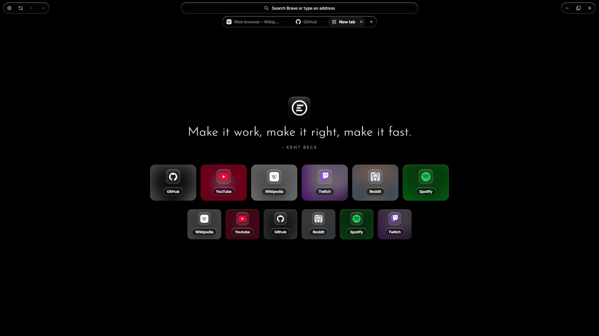
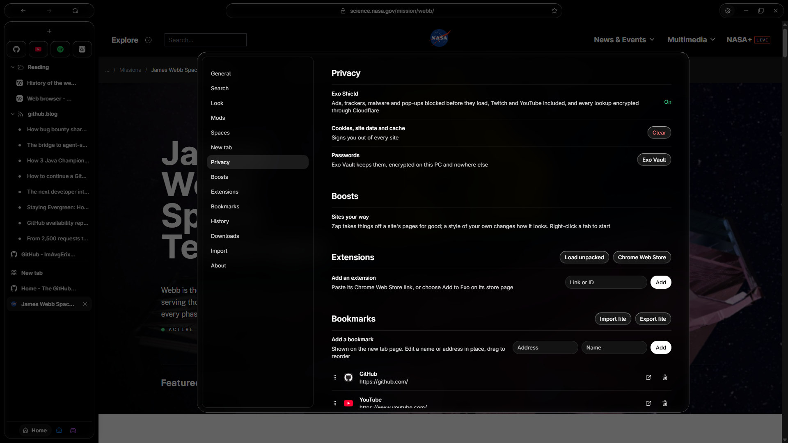
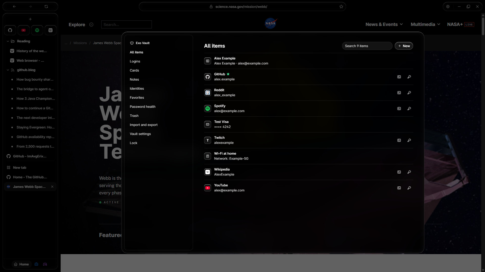
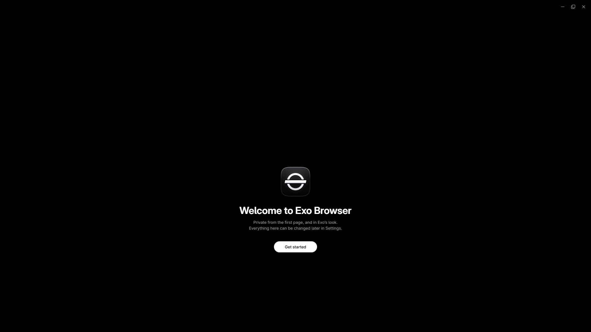

<h1 align="center">Exo Browser 1.0</h1>

<strong>A private, fast browser in Exo's look.</strong>

Ads, trackers and Twitch ad breaks gone before they load, your passwords encrypted on your own PC, and one Liquid Glass window for Windows 11.

<a href="https://github.com/ImAvgErix/ExoBrowser/releases/latest/download/ExoBrowser-Setup.exe"><strong>Download for Windows 11</strong></a> · <a href="https://github.com/ImAvgErix/ExoBrowser/releases/tag/v1.0.2">What's new in 1.0</a> · <a href="CHANGELOG.md">Changelog</a> · <a href="PRIVACY.md">Privacy</a>

## Why Exo Browser

Most browsers make you choose: a blocker you have to set up, a password manager that wants an account, and a look you can't change. Exo Browser comes with the best of each already on, and nothing to configure.

- **Blocking that's always at its best.** Exo Shield is built in and always on, at its strongest: ads, trackers, malware, cookie notices and pop-ups are blocked before they load, on every site. There is no setting to get wrong and nothing a site can switch off.
- **YouTube and Twitch without ads.** YouTube's ads are blocked like any other. Twitch puts its ads inside the stream itself, so Exo Shield asks for each stream from a country Twitch shows no ads in; the video still comes straight from Twitch, at full quality.
- **Your passwords stay yours.** Exo Vault keeps your logins, cards, notes and identities encrypted on this PC, with no account and no cloud. It fills sign-in forms, makes strong passwords, shows 2FA codes and opens with Windows Hello.
- **Private by default.** Every address lookup goes encrypted to Cloudflare, Microsoft Edge's balanced tracking prevention is on, and there is no Exo account, no ads and no telemetry.
- **Made to look at.** Exo Launcher's look: Liquid Glass on everything that floats, Inter type, Light, Dark or Void (pure black, for OLED screens), and tabs across the top or down the side.
- **Easy to move in.** One click brings your bookmarks, history, sign-ins, extensions and passwords from the other browsers on this PC.

## How it works

Exo Browser is a native Windows app (C++) built on Microsoft Edge WebView2, the Chromium engine that comes with Windows and that Windows keeps up to date. Pages render exactly as they do in Edge and Chrome, and Chrome Web Store extensions work.

- **Its own interface.** The Bar, the new tab page, Settings and Exo Vault are Exo Browser's own pages, drawn in their own profile with no extensions and no access to the web.
- **Exo Shield** is uBlock Origin Lite with HaGeZi's Multi PRO list and TTV LOL PRO, merged into one built-in extension. Its lists ship with the browser, so it fetches nothing to block.
- **Exo Vault** is one file on your PC, encrypted with AES-256-GCM by Windows. Its key comes from your master password through Argon2id (256 MiB of memory, so guessing is slow), and Windows Hello can open it too.

## Exo Shield

Exo Shield blocks before anything loads, on every site:

- **Ads and trackers:** uBlock Origin Lite's filters with complete filtering everywhere (the extension's strongest mode), plus HaGeZi's Multi PRO list of about 200,000 ad, tracking and malware sites.
- **Annoyances:** cookie notices, overlays, notification prompts, chat and social widgets, and tracking parameters stripped from links.
- **Twitch:** TTV LOL PRO, set to send nothing about you to its developers.
- **Secure DNS:** every lookup over HTTPS to Cloudflare, with no unencrypted fallback.

It is locked on: it has no settings, it can't be turned off or removed, and every start puts its rules back exactly. Settings > About lists its parts and when its lists were built.

## Exo Vault

A password manager in the browser, with everything kept on this PC:

- **What it keeps:** logins with 2FA codes, cards, secure notes and identities, with favorites, a trash and each login's earlier passwords.
- **Signing in:** a menu on sign-in fields fills your login, and Exo Vault offers to save a new one or update a changed one.
- **Password health:** weak passwords, passwords used on more than one site, and sites that offer 2FA where you haven't set it up, worked out on your PC.
- **Locked when you're away:** after the time you choose, when Windows locks and when the PC sleeps. A copied password leaves the clipboard after 30 seconds and never reaches Windows' clipboard history.
- **Moving in and out:** bring passwords from the browsers on this PC, or from a Proton Pass, Bitwarden, 1Password, LastPass, Dashlane, KeePass, Safari or any browser's export. Export everything as one encrypted file to open on another PC.

Nobody can reset your master password, Exo included, so pick one you'll remember.

## First run

The first time it opens, Exo Browser walks you through making your vault, bringing your things from your other browsers, picking your look and making it your default browser. Every step can be skipped and changed later in Settings.

## Privacy and safety

- **No Exo account, no ads, no analytics, no telemetry.** Exo Browser has no server of its own. Your history, bookmarks, settings and vault stay in `%LocalAppData%\ExoBrowser`.
- **What leaves your PC** is what browsing needs: the sites you open, your address lookups (to Cloudflare), your searches (to the search engine you pick), the Twitch playlist requests Exo Shield routes, Chrome Web Store downloads when you add an extension, and the update check to GitHub. The [privacy policy](PRIVACY.md) lists every destination and what is sent.
- **Your passwords never leave this PC** unless you export them yourself, and an export is encrypted with a password you choose.

## Install

1. Download **[ExoBrowser-Setup.exe](https://github.com/ImAvgErix/ExoBrowser/releases/latest/download/ExoBrowser-Setup.exe)**.
2. Run it and choose Install, then Launch Exo Browser. First run sets up Exo Vault, brings your things over and offers to make Exo Browser your default browser.
3. New versions show in **Settings > About**: **Install update** downloads it, checks it and installs it over the one you have, and your tabs, history, sign-ins and vault stay.

**Requirements:** Windows 11 x64 with WebView2 (built into Windows 11; Setup installs it if it's missing). Exo Browser installs for your Windows user only, in `%LOCALAPPDATA%\ExoBrowser\app`, and needs no administrator rights. The installer isn't code-signed yet, so Windows SmartScreen may warn the first time; choose **More info**, then **Run anyway**. Each release lists the installer's SHA-256 so you can check your download.

## License and legal

- **Exo Browser** is free for personal use under its own [terms](LICENSE), provided as is, without warranty. Its source is in this repository for anyone to read and check, but it is not open source: copying it, forking it outside GitHub or publishing changed versions needs written permission.
- **Open-source parts that ship with Exo Browser** keep their own licenses, and their source is public:
  - [Exo Shield](https://github.com/ImAvgErix/exo-shield) (GPL-3.0), made from uBlock Origin Lite, HaGeZi's DNS blocklists and TTV LOL PRO.
  - Argon2 (CC0), for Exo Vault's key.

  Every bundled library, font and tool is listed in [Third-party notices](THIRD_PARTY_NOTICES.md), and [Building Exo Browser](docs/DEVELOPING.md) says how the source fits together.
- **Not affiliated.** Exo Browser is an independent product, not affiliated with or endorsed by Microsoft, Google, Cloudflare, Twitch, YouTube, the uBlock Origin, HaGeZi or TTV LOL PRO projects, or any password manager or website it works with. Their names and logos belong to their owners. Your use of each site and service stays under its own terms.

[Report an issue](https://github.com/ImAvgErix/ExoBrowser/issues) · [Support development](https://www.buymeacoffee.com/UhhErix)

© 2026 Erix ([ImAvgErix](https://github.com/ImAvgErix)).
